<!-- Dark-locked by design: all cards are OLED black. Cyberpunk system: cyan accent, mono idiom. -->



<p align="center">
  
</p>


## $ whoami

> Software Engineering student at **Babcock University** (200 level), learning to build for the web one day at a time.

No big claims, no shipped products yet. Just consistent daily work and honest progress. I started with the fundamentals taught in school and I'm building on them every day. Every repo here is a snapshot of where I am, not where I want to be.

## $ ls ~/stack

<p align="center">
  
</p>

## $ cat now.txt

```bash
$ cat now.txt
[2026-11] deepening javascript beyond classroom material
[2026-11] turning tutorials into small, real projects
[2026-11] reading docs first, videos second
[2026-11] getting fluent with git & github
$ █
```

## $ ./stats.sh

<!-- snapshot pulled from the GitHub API on 2026-11-05 -->

```bash
$ gh profile --user posi946
  joined ........ nov 2025
  public repos .. 6
  current stack . html / css / javascript / python
$ _
```

<p align="center">
  
</p>

## $ pacman -S commits

<picture>
  <source media="(prefers-color-scheme: dark)" srcset="https://raw.githubusercontent.com/posi946/posi946/output/pacman-contribution-graph-dark.svg">
  <source media="(prefers-color-scheme: light)" srcset="https://raw.githubusercontent.com/posi946/posi946/output/pacman-contribution-graph.svg">
  
</picture>

## $ ssh connect

<p align="center">
  <a href="https://github.com/posi946">
    
  </a>
</p>

Open to feedback, collabs, and messages from anyone on a similar path. More links loading as I build my presence.


<p align="center">
  <em>"I keep trying to improve everyday, and I do."</em>
</p>
<p align="center">
  <sub>// EOF</sub>
</p>
