<!-- ══ header ══ -->

<table align="center">
  <tr>
    <td width="28%" align="center">
      
    </td>
    <td width="72%" align="left">
      
    </td>
  </tr>
</table>

  

<!-- ══ whoami ══ -->
## // whoami

I'm at the beginning of my journey as a developer. No big claims, no shipped products yet, just consistent daily work and honest progress. Every repo here is a snapshot of where I am, not where I want to be. If you're on a similar path, follow along.

<!-- ══ stack ══ -->
## // tech_stack

  
  
  
  
  
  
  

<!-- ══ certifications ══ -->
## // certifications

  

<!-- ══ right now ══ -->
## // right_now

- learning Java alongside JavaScript
- deepening my JavaScript beyond classroom material
- building small projects to turn tutorials into actual skill
- reading documentation instead of only following videos

<!-- ══ contributions ══ -->
## // watch_my_commits_get_eaten

  <picture>
    <source media="(prefers-color-scheme: dark)" srcset="https://raw.githubusercontent.com/posi946/posi946/output/pacman-contribution-graph-dark.svg">
    <source media="(prefers-color-scheme: light)" srcset="https://raw.githubusercontent.com/posi946/posi946/output/pacman-contribution-graph.svg">
    
  </picture>

<!-- ══ footer ══ -->
## // find_me

- GitHub: you're already here (@posi946)
- More links coming as I build my presence

---

  <em>"I keep trying to improve everyday, and I do."</em>

