<!-- ══ header ══ -->

<table align="center">
  <tr>
    <td width="28%" align="center">
      
    </td>
    <td width="72%" align="left">
      
    </td>
  </tr>
</table>

  

<!-- ══ whoami ══ -->
## // whoami

I'm early in this, and I'd rather show the work than describe it. Everything here is something I actually built and can explain: small tools, coursework pushed past the brief, and one project shipped end to end. The commits are the résumé.

<!-- ══ featured ══ -->
## // featured

**[ScamShield](https://posi946.github.io/scamshield/)** · [source](https://github.com/posi946/scamshield)

A free, private scam-message checker. Paste a suspicious text, email, or DM and it names the warning signs, scores the risk from 0 to 100, and says what to do next. Plain HTML, CSS, and JavaScript — no account, no server, no analytics, nothing you paste leaves the tab. Installable and works offline.

<!-- ══ stack ══ -->
## // tech_stack

  
  
  
  
  
  
  

<!-- ══ certifications ══ -->
## // certifications

  

<!-- ══ right now ══ -->
## // right_now

- learning Java alongside JavaScript
- deepening my JavaScript beyond classroom material
- building small projects to turn tutorials into actual skill
- reading documentation instead of only following videos

<!-- ══ contributions ══ -->
## // watch_my_commits_get_eaten

  <picture>
    <source media="(prefers-color-scheme: dark)" srcset="https://raw.githubusercontent.com/posi946/posi946/output/pacman-contribution-graph-dark.svg">
    <source media="(prefers-color-scheme: light)" srcset="https://raw.githubusercontent.com/posi946/posi946/output/pacman-contribution-graph.svg">
    
  </picture>

<!-- ══ footer ══ -->
## // find_me

- GitHub: you're already here (@posi946)
- More links coming as I build my presence

---

  <em>"I keep trying to improve everyday, and I do."</em>

